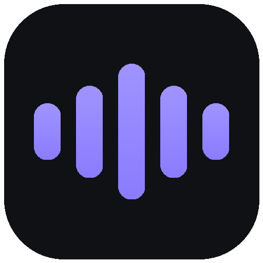

<p align="center">
  
</p>

<h1 align="center">NovaVoice</h1>

<p align="center">
  Natural neural text-to-speech workspace — <b>Uzbek + 150 languages</b>, MP3 download, named records.
</p>

<p align="center">
  
  
  
  
  
</p>

## Features

- 🇺🇿 **Uzbek voices included** — Madina (female) & Sardor (male), plus 320+ neural voices
- 🎛 Speed / pitch / volume controls with live values
- ⬇ MP3 download and 💾 **named records** — save, rename, replay, delete
- 🔍 Voice search + language & gender filters, featured voices
- 📱 Installable on Android (PWA — same Wi-Fi, Add to Home Screen)
- ⌨️ `Ctrl + Enter` to generate, character counter, duration estimate
- 🔒 Self-hosted — runs on your own machine, no accounts, no subscriptions

## Quickstart

**Windows (easiest):** double-click `NovaVoice TTS.lnk` in the folder root (or `app/START-TTS.bat`) — it installs what's missing and opens the app at `http://127.0.0.1:5005`.

**Manual (Windows / macOS / Linux):**

```bash
cd app
pip install -r requirements.txt
python app.py
```

Then open `http://127.0.0.1:5005`. On the same Wi-Fi, phones can use `http://<your-pc-ip>:5005`.

## Project structure

```
NovaVoice/                  # repo root
├── README.md / LICENSE
├── NovaVoice TTS.lnk       # Windows double-click launcher (local only, not in git)
├── .github/FUNDING.yml     # sponsorship links (edit me)
└── app/                    # the application
    ├── app.py              # Flask backend + edge-tts
    ├── requirements.txt
    ├── START-TTS.bat       # Windows launcher backend
    ├── novavoice-logo.png  # logo + icons (.ico)
    ├── static/
    │   ├── index.html      # the whole UI (no framework)
    │   ├── manifest.webmanifest / sw.js   # PWA
    │   └── logo.png, icon-*.png
    ├── audio_cache/        # generated MP3s (local, git-ignored)
    └── records.json        # your named records (local, git-ignored)
```

## API

| Method | Endpoint              | Description                              |
| ------ | --------------------- | ---------------------------------------- |
| GET    | `/api/voices`         | All voices, locales, featured list       |
| GET    | `/api/health`         | Status + LAN address                     |
| POST   | `/api/speak`          | `{text, voice, rate, pitch, volume}` → MP3 |
| POST   | `/api/download`       | Same + `name` → MP3 download with that name |
| GET    | `/api/records`        | Named records library                    |
| POST   | `/api/records`        | Save MP3 blob as a named record          |
| PUT    | `/api/records/<id>`   | Rename a record                          |
| DELETE | `/api/records/<id>`   | Delete a record + its file               |
| GET    | `/audio/<file>`       | Serve a saved MP3                        |

## Notes

- Voices come from Microsoft Edge's neural TTS via the `edge-tts` package (unofficial endpoint, internet required). Heavy public traffic may get throttled — for personal and light use it's fine.
- `audio_cache/` and `records.json` are local runtime data and are intentionally git-ignored.

## Support NovaVoice

If this project is useful to you, you can support its development:

- ⭐ Star the repo — it helps more than you think
- 💜 [Sponsor on GitHub](https://github.com/sponsors/Srch-Unknown-user) — support ongoing development
- 💎 Donate USDT (**TON network only**): `UQD4stkVdOoKw79AwGFDeHLURUg8jur2ZPCv7f-bKQ9KEY2S`

## License

MIT — see [LICENSE](LICENSE). Replace the copyright holder name with your own before publishing.
